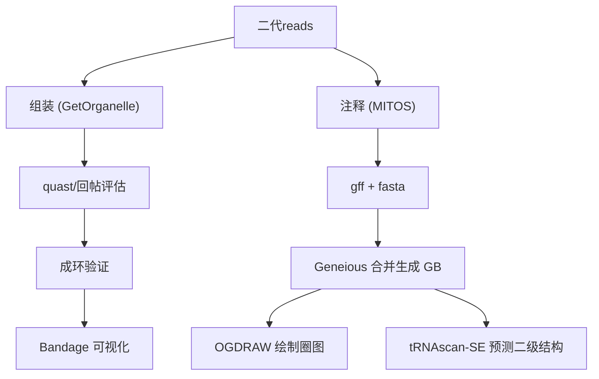

> 从二代测序 reads 中组装出完整的线粒体基因组：GetOrganelle / MITObim 组装 → 成环验证 → 注释 → 圈图。

## 背景 / 适用场景

- **适用**：真菌、植物、动物等物种，想从全基因组测序数据里单独组装出环状的线粒体基因组。
- **为什么单独组装**：线粒体序列在总数据里占比低、AT 含量高，和核基因组混着拼容易碎；用专门的"种子序列 + 扩展"策略更完整。

## 输入与输出

| 类型 | 内容 |
| --- | --- |
| 输入 | 双端 reads `sample_R1.fq.gz` / `sample_R2.fq.gz`；近缘参考线粒体序列 `reference.fasta`（作种子） |
| 输出 | 组装序列 `*.path_sequence.fasta`；评估报告；成环验证比对；注释后的 GB/GFF；圈图 |

## 环境依赖

```bash
conda install -c bioconda getorganelle
# 首次用真菌线粒体预设，先注册
get_organelle_config.py --add fungus_mt
# MITObim（方法二）单独安装，见其官方文档
```

---

## 方法一：GetOrganelle（推荐）

### 1. 单样本组装

```bash
get_organelle_from_reads.py \
    -1 sample_R1.fq.gz -2 sample_R2.fq.gz \
    -o sample_out \
    -R 20 \
    -k 21,45,65,85 \
    -P 500000 \
    -F fungus_mt \
    -s reference.fasta \
    --spades-options "--memory 32 -t 4 --isolate"
```

> 参数说明：
> - `-R 20`：从种子向外扩展的最大轮数（越大越可能把环补完整）。
> - `-k 21,45,65,85`：SPAdes 的 k-mer 组合，多组 k 有助于跨重复区。
> - `-P 500000`：预读取参数，加速初始分析。
> - `-F fungus_mt`：用真菌线粒体预设（动物 `animal_mt`、植物 `embplant_pt` 等，用 `get_organelle_config.py -h` 查）。
> - `-s`：近缘参考序列，作起始种子。
>
> 结果文件：`sample_out/fungus_mt.K85.complete.graph1.1.path_sequence.fasta`（完整路径会因 k 值不同而变化，找 `*.complete.*.path_sequence.fasta` 即可）。

### 2. 组装质量评估

```bash
evaluate_assembly_using_mapping.py \
    -f sample_out/fungus_mt.K85.complete.graph1.1.path_sequence.fasta \
    -1 sample_R1.fq.gz -2 sample_R2.fq.gz \
    -o eval_out -c no --draw
# 看 reads 回帖率：高覆盖、无大缺口说明组装完整
```

### 3. 批量脚本

```bash
#!/bin/bash
# 目录结构要求：./raw_data/ 放 reads，./reference/ 放参考种子
shopt -s nullglob
for f in ./raw_data/*_good_1.fq.gz; do
    sample=$(basename "${f}" _good_1.fq.gz)
    echo "==> 处理 ${sample}"

    get_organelle_from_reads.py \
        -1 "./raw_data/${sample}_good_1.fq.gz" \
        -2 "./raw_data/${sample}_good_2.fq.gz" \
        -o "${sample}" \
        -R 20 -k 49,57,65,73 -P 500000 \
        -F fungus_mt \
        -s "./reference/reference.fasta" \
        --spades-options "--memory 32 -t 4 --isolate"

    assembly="${sample}/fungus_mt.K85.complete.graph1.1.path_sequence.fasta"
    if [ ! -f "${assembly}" ]; then
        echo "[WARN] ${sample} 组装失败，跳过评估"; continue
    fi
    ( cd "${sample}" && evaluate_assembly_using_mapping.py \
        -f "fungus_mt.K85.complete.graph1.1.path_sequence.fasta" \
        -1 "../raw_data/${sample}_good_1.fq.gz" \
        -2 "../raw_data/${sample}_good_2.fq.gz" \
        -o "${sample}_eval" -c no --draw )
done
echo "全部完成"
```

---

## 方法二：MITObim（备选）

> MITObim 需要先把双端 reads 合并成 interleaved（R1/R2 交替）格式，并做 `/1`、`/2` 标记。

```bash
# 1. 合并双端为 interleaved
shuffle.sh in1=sample_R1.fq.gz in2=sample_R2.fq.gz \
    out=sample_interleaved.fq.gz overwrite=true ziplevel=9

# 2. 给 reads 名加 /1 /2 后缀（MITObim 识别配对靠这个）
zcat sample_interleaved.fq.gz \
    | sed '/^@.* 1:/s/$/\/1/; /^@.* 2:/s/$/\/2/' \
    | gzip > sample_interleaved_fixed.fq.gz

# 3. 组装（LC_ALL=C 防止中文字符环境报错）
LC_ALL=C MITObim.pl -start 1 -end 10 \
    -sample sample \
    -ref reference.fasta \
    -readpool sample_interleaved_fixed.fq.gz \
    --quick reference.fasta

# 4. 结果检验：blastn 或 MUMmer
blastn -query sample.consensus.fasta -subject reference.fasta -outfmt 6
nucmer reference.fasta sample.consensus.fasta
mummerplot --png --prefix=comparison out.delta
```

---

## 成环验证（关键步骤）

> 环状线粒体的特征是：序列首尾有重叠。提取首尾各 50 bp，做全局比对看是否重叠。

```python
# 提取组装序列首尾各 50 bp
from Bio import SeqIO
input_file = "sample.path_sequence.fasta"
record = next(SeqIO.parse(input_file, "fasta"))
with open("head50.fa", "w") as h:
    h.write(f">head50\n{record.seq[:50]}\n")
with open("tail50.fa", "w") as t:
    t.write(f">tail50\n{record.seq[-50:]}\n")
print(f"序列长度: {len(record.seq)} bp")
```

```bash
# water 是 EMBOSS 套件里的全局比对，看首尾重叠程度
water head50.fa tail50.fa -gapopen 10 -gapextend 0.5 -outfile overlap.aln

# 也可以用 seqkit 直接切
seqkit subseq -r 1:50 reference.fasta > head50.fa
seqkit subseq -r -50:-1 reference.fasta > tail50.fa
```

```bash
# 用 Bandage 可视化组装图（直接看是否成环）
# 把 FASTA 转成单序列 GFA（形成环状连接）
FASTA=$1
OUTPUT=${FASTA%.*}.gfa
SEQ=$(seqkit seq -s -w 0 $FASTA)
LEN=${#SEQ}
NAME=$(seqkit seq -n $FASTA | head -1)
printf "H\tVN:Z:1.0\nS\t1\t%s\tLN:i:%s\nL\t1\t+\t1\t+\t0M\n" "$SEQ" "$LEN" > $OUTPUT
echo "Now run: Bandage load $OUTPUT"
```

---

## 线粒体注释与圈图

```markdown
- 注释：
  - GeSeq 在线：https://chlorobox.mpimp-golm.mpg.de/geseq.html
  - MITOS2 在线：https://usegalaxy.org/（搜 mitos2 工具）
- 圈图：
  - OGDRAW：https://chlorobox.mpimp-golm.mpg.de/OGDraw.html
  - 需要 GB 格式文件；可先把 FASTA + GFF 在 Geneious 里合并导出为 GB，再上传 OGDRAW
```

---

## 流程图



---

## 常见问题

- **组装结果找不到 `*.complete.*` 文件**：说明没有组装成完整环，可增大 `-R`、换 k-mer 组合、或换更近缘的 `-s` 种子序列。
- **MITObim 报编码/配对错误**：先 `LC_ALL=C` 再跑，并确认 interleaved 文件里 reads 名带 `/1`、`/2` 后缀。
- **首尾不重叠（未成环）**：可能是线性分子或组装不完整，用 Bandage 看组装图确认是否真环。
- **GetOrganelle 用 `-F fungus_mt` 报错**：先执行 `get_organelle_config.py --add fungus_mt` 注册预设，或直接写 `-F embplant_pt` 等已注册的库。
