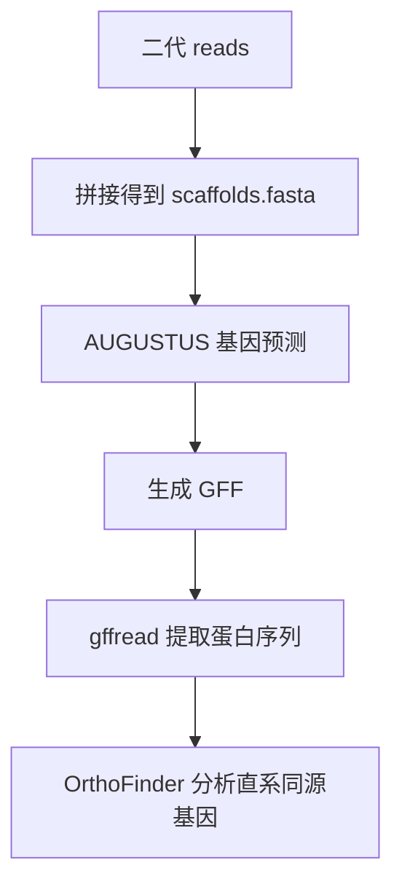

> 从多个物种的二代 reads 出发，拼接 → AUGUSTUS 预测基因 → gffread 提取蛋白 → OrthoFinder 找直系同源基因。

## 背景 / 适用场景

- **适用**：比较多个物种（菌株）的基因家族、找直系同源基因、做系统发育或功能比较。
- **核心思路**：每个物种各拼一个基因组、各预测一套蛋白，再把所有蛋白丢给 OrthoFinder 聚类。

## 输入与输出

| 类型 | 内容 |
| --- | --- |
| 输入 | 每个物种的双端 reads；或已拼接好的 `scaffolds.fasta` |
| 输出 | 每个物种的 GFF（基因预测）、蛋白序列 `*.faa`；OrthoFinder 的 `Orthogroups` 结果 |

## 环境依赖

```bash
conda install -c bioconda spades augustus gffread orthofinder mafft diamond
```

## 流程图



---

## 步骤

### 1. 质控 + 拼接

```bash
# 质控
java -jar $SOFTWARE_DIR/Trimmomatic-0.39/trimmomatic-0.39.jar PE -threads 8 \
    sample_R1.fq.gz sample_R2.fq.gz \
    sample_R1.paired.fq.gz sample_R1.unpaired.fq.gz \
    sample_R2.paired.fq.gz sample_R2.unpaired.fq.gz \
    ILLUMINACLIP:$SOFTWARE_DIR/Trimmomatic-0.39/adapters/TruSeq3-PE-2.fa:2:30:10 \
    LEADING:5 TRAILING:5 SLIDINGWINDOW:4:15 MINLEN:50 TOPHRED33

# 拼接
spades.py --isolate -t 16 -m 64 -k 21,33,55,77,99 --cov-cutoff auto \
    -1 sample_R1.paired.fq.gz -2 sample_R2.paired.fq.gz -o spades_out
```

### 2. AUGUSTUS 基因预测

```bash
# 用近缘物种的已训练模型（以鬼伞 coprinus_cinereus 为例）
augustus --species=coprinus_cinereus --gff3=on \
    --stopCodonExcludedFromCDS=false \
    spades_out/scaffolds.fasta > sample.gff3

# 查看可用物种模型
augustus --species=help
```

> 若没有合适的近缘物种模型，需要**自己训练**（流程见文末附录）。

### 3. gffread 提取蛋白序列

```bash
# 去掉注释行（# 开头），得到干净的 GFF3
gffread -E -o sample.clean.gff3 sample.gff3

# 从 GFF3 + 基因组提取蛋白（-y）、CDS（-x）、转录本（-w）
gffread sample.clean.gff3 -g spades_out/scaffolds.fasta -y sample.faa
# 可选：gffread sample.clean.gff3 -g genome.fa -x cds.fa
# 可选：gffread -g genome.fa -y proteins.faa -K prediction.gff3   # -K 保留 UTR 信息
```

> 注意：**每个物种内蛋白序列 ID 必须唯一**，否则 OrthoFinder 会报错或合并错误。

### 4. OrthoFinder 找直系同源基因

```bash
# 把每个物种的 .faa 放到同一目录 data/，文件名用物种名
mkdir -p data
cp sample1.faa data/sample1.faa
cp sample2.faa data/sample2.faa

orthofinder -f ./data -t 16 -a 8 -M msa -S blast -A mafft -T raxml-ng
```

> 参数说明：
> - `-f` 蛋白目录；`-t` 比对线程；`-a` 分析线程。
> - `-M msa` 用多序列比对法推断基因树；`-S blast` 用 BLAST 做同源搜索（默认 diamond 更快）。
> - `-A mafft` 比对软件；`-T raxml-ng` 画树软件（默认 fasttree）。
>
> 结果在 `data/OrthoFinder/Results_*/` 里，核心文件 `Orthogroups.tsv`、`Orthogroups.GeneCount.tsv`。

---

## 完整批量脚本（每个物种跑一遍全流程）

```python
import os

BASE_DIR = os.getcwd()
CONFIG = {
    'trimmomatic': "$SOFTWARE_DIR/Trimmomatic-0.39/trimmomatic-0.39.jar",   # 改成实际路径
    'adapters': "$SOFTWARE_DIR/Trimmomatic-0.39/adapters/TruSeq3-PE-2.fa",
    'augustus_species': "coprinus_cinereus",
    'threads': "10",
    'spades_memory': "64",
}

def run(cmd, desc=""):
    print(f"[{desc}] {cmd}")
    return os.system(cmd) == 0

def process_sample(sample):
    """单个物种：质控 → 拼接 → 预测 → 提蛋白"""
    r1 = os.path.join(BASE_DIR, sample, f"{sample}_1.clean.fq.gz")
    r2 = os.path.join(BASE_DIR, sample, f"{sample}_2.clean.fq.gz")
    if not (os.path.exists(r1) and os.path.exists(r2)):
        print(f"跳过 {sample}: 输入缺失"); return False

    trim = os.path.join(sample, "00.trim", sample)
    os.makedirs(os.path.dirname(trim), exist_ok=True)
    os.makedirs(os.path.join(sample, "01.spades", "assembly_1"), exist_ok=True)
    os.makedirs(os.path.join(sample, "02.augustus"), exist_ok=True)
    os.makedirs(os.path.join(sample, "03.annot"), exist_ok=True)

    if not run(f"java -jar {CONFIG['trimmomatic']} PE -threads {CONFIG['threads']} "
               f"{r1} {r2} {trim}_1.fq.gz {trim}_1.u.fq {trim}_2.fq.gz {trim}_2.u.fq "
               f"ILLUMINACLIP:{CONFIG['adapters']}:2:30:10 "
               "LEADING:5 TRAILING:5 SLIDINGWINDOW:4:15 MINLEN:50 TOPHRED33", "质控"):
        return False

    asm = os.path.join(sample, "01.spades", "assembly_1")
    if not run(f"spades.py --isolate -t {CONFIG['threads']} -m {CONFIG['spades_memory']} "
               f"-k 21,33,55,77,99 --cov-cutoff auto -1 {trim}_1.fq.gz -2 {trim}_2.fq.gz -o {asm}", "拼接"):
        return False

    scaffolds = os.path.join(asm, "scaffolds.fasta")
    gff = os.path.join(sample, "02.augustus", "scaffolds.gff")
    if not run(f"augustus --species={CONFIG['augustus_species']} {scaffolds} > {gff}", "预测"):
        return False

    protein = os.path.join(sample, "03.annot", "scaffolds.faa")
    if not run(f"gffread {gff} -g {scaffolds} -y {protein}", "提蛋白"):
        return False

    # 复制到 OrthoFinder 目录
    ortho = os.path.join(BASE_DIR, "04.orthofinder_input")
    os.makedirs(ortho, exist_ok=True)
    os.system(f"cp {protein} {ortho}/{sample}.faa")
    return True

def main():
    samples = [d for d in os.listdir(BASE_DIR)
               if os.path.isdir(os.path.join(BASE_DIR, d)) and d not in ("04.orthofinder_input",)]
    ok = [s for s in samples if process_sample(s)]

    if len(ok) >= 2:
        run(f"orthofinder -f 04.orthofinder_input -t {CONFIG['threads']}", "OrthoFinder")
    else:
        print("至少需要 2 个物种成功才能跑 OrthoFinder")

if __name__ == "__main__":
    main()
```

---

## 附录：AUGUSTUS 自训练（没有现成物种模型时）

> 大致流程：用近缘物种预测 → 过滤低质量基因 → 划分训练/测试集 → 循环训练优化 → 用训练好的模型预测。

```bash
# 1. 把参考物种的 GFF3 + 基因组转成 GB 格式（1000 bp 侧翼）
perl gff2gbSmallDNA.pl ref_gene.gff3 ref_genome.fa 1000 genes.raw.gb

# 2. 初始化新物种配置（物种名自定）
new_species.pl --species=my_species

# 3. 用 generic 模型先试训练，捕捉错误基因
etraining --species=generic --stopCodonExcludedFromCDS=false genes.raw.gb 2> train.err

# 4. 过滤掉报错的基因结构
cat train.err | perl -pe 's/.*in sequence (\S+): .*/$1/' > badgenes.lst
filterGenes.pl badgenes.lst genes.raw.gb > genes.gb

# 5. 自身 blastp，去掉 identity >= 70% 的冗余基因
grep '/gene' genes.gb | sort | uniq | sed 's/\/gene=//g;s/"//g' | awk '{print $1}' > geneSet.lst
seqkit grep -f geneSet.lst ref_pep.fa > geneSet.fa
makeblastdb -in geneSet.fa -dbtype prot -parse_seqids -out geneSet.fa
blastp -db geneSet.fa -query geneSet.fa -out geneSet.blastp -evalue 1e-5 -outfmt 6 -num_threads 8
python delete_high_identity_gene.py geneSet.blastp ref_gene.gff3   # 脚本需自写，按 blastp 结果去冗余

# 6. 过滤后的 GFF3 再转 GB
perl gff2gbSmallDNA.pl gene_filter.gff3 ref_genome.fa 1000 genes.gb.filter

# 7. 随机分成训练集 + 测试集（测试集 100 个基因，训练集至少 200 个 LOCUS）
randomSplit.pl genes.gb.filter 100

# 8. 初始化物种参数并训练
new_species.pl --species=my_species
etraining --species=my_species genes.gb.filter.train

# 9. 用测试集检验（和近缘物种模型对比）
augustus --species=my_species genes.gb.filter.test | tee firsttest.out
augustus --species=arabidopsis genes.gb.filter.test | tee firsttest_ara.out
# 结尾统计里 TP/FP/FN/TN 是预测准确性指标（TP 真阳性、FP 假阳性、FN 假阴性、TN 真阴性）

# 10. 循环优化参数（k-fold 交叉验证）
optimize_augustus.pl --species=my_species --rounds=5 --cpus=8 genes.gb.filter.train

# 11. 用 CRF 再训练一次，比较前后准确率
etraining --species=my_species --CRF=1 genes.gb.filter.train
augustus --species=my_species genes.gb.filter.test | tee secondtest.out.withCRF
# 若 CRF 后准确率更高则用 CRF 模型，否则用第 10 步结果
```

---

## 常见问题

- **OrthoFinder 报蛋白 ID 重复**：不同物种的 ID 允许重复，但**同一物种内**必须唯一；用 `seqkit rename` 统一加物种前缀。
- **AUGUSTUS 找不到 `--species` 模型**：先 `augustus --species=help` 看有哪些；没有就用近缘的，或走自训练流程。
- **gffread 提取的蛋白为空**：GFF 里 CDS 坐标或相位有问题，先 `gffread -E` 清掉注释行，确认 GFF 里确实有 `CDS` 行。
- **AUGUSTUS 预测质量差**：真菌/细菌等非模式物种用默认模型效果有限，优先用近缘已训练模型，或自训练。
